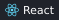
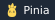
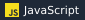
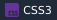
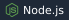
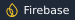
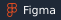

<!--  HEADER SECTION -->
<h1 align="center">
  
</h1>
<h3 align="center">AI-Focused Full-Stack Web & Mobile Developer</h3>

  

### 💫 About Me:

  

- 💼 Flutter Developer with **5+ months of experience**
- 📱 Built & deployed **2+ production-ready apps** on Google Play Store & Apple App Store

  

### 🌐 Socials

  
  
  
  

### 💻 Tech Stack:

<table>
  <tr>
    <td valign="top" width="160"><b>Frameworks</b></td>
    <td>
      
      
      
      
    </td>
  </tr>
  <tr>
    <td valign="top"><b>State & Auth</b></td>
    <td>
      
      
    </td>
  </tr>
  <tr>
    <td valign="top"><b>Languages & UI</b></td>
    <td>
      
      
      
      
    </td>
  </tr>
  <tr>
    <td valign="top"><b>Backend & Data</b></td>
    <td>
      
      
      
      
    </td>
  </tr>
  <tr>
    <td valign="top"><b>Tools</b></td>
    <td>
      
      
      
      
    </td>
  </tr>
</table>

## GitHub Status

  <picture>
    <source media="(prefers-color-scheme: dark)" srcset="https://github-profile-summary-cards.vercel.app/api/cards/profile-details?username=kakamruldev&theme=github_dark" />
    
  </picture>
  <picture>
    <source media="(prefers-color-scheme: dark)" srcset="https://github-profile-summary-cards.vercel.app/api/cards/stats?username=kakamruldev&theme=github_dark" />
    
  </picture>
  <picture>
    <source media="(prefers-color-scheme: dark)" srcset="https://github-profile-summary-cards.vercel.app/api/cards/repos-per-language?username=kakamruldev&theme=github_dark" />
    
  </picture>

 

<!--  DIVIDER LINE -->

  

<!--  Fire Image -->

 

# 💼 Professional Experience

**Junior Flutter & BackEnd Developer**  
Softvench Delta — Dhaka, Bangladesh  
*January 2026 – Present*

- Built scalable apps, reducing crashes by **30%**  
- Published **2 apps** on Play Store & App Store  
- Collaborated with **18+ team members**  
- Fixed **20+ performance issues** → **99.9% responsiveness**  
- Improved code quality by **25%** through code reviews  

**Flutter Developer Intern**  
SoftVence Delta (Betopia Group Limited) — Dhaka, Bangladesh  
*January 2026 – March 2026*

- Collaborated on scalable Flutter applications using **Riverpod** state management  
- Improved runtime performance by 30% and reduced app size by 20% via code & asset optimization  
- Transformed raw data into intuitive, data-driven user interfaces  

<!-- Final animated sparkling wave divider -->

  

👉 Reach out: kakamrul2000@gmail.com

